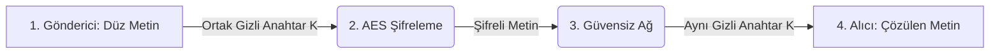
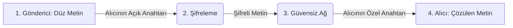
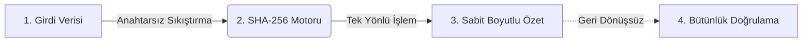

# 🔐 Kriptografi Veri Akış Şemaları ve NIST Anahtar Boyutu Analizi

## ⚡ 1. Kriptografi Veri Akış Şemaları

### 🔑 Simetrik Şifreleme (AES-256) Akışı


### 🛡️ Asimetrik Şifreleme (RSA / ECC) Akışı


### 🧬 Özetleme / Hash Fonksiyonu (SHA-256) Akışı


---

## 📊 2. NIST Anahtar Boyutu Karşılaştırma Grafiği (128-Bit Güvenlik Seviyesi)

Aynı güvenlik gücünü (**128-bit standart güvenlik**) elde etmek için algoritmaların ihtiyaç duyduğu anahtar/çıktı boyutları:

```text
Algoritma               Anahtar Boyutu   Oransal Görünüm (Logaritmik)
──────────────────────────────────────────────────────────────────────────────────
AES-128 (Simetrik)      128 bit          █████░░░░░░░░░░░░░░░░░░░░░░░░░ (1x)
ECC P-256 (Asimetrik)   256 bit          ██████████░░░░░░░░░░░░░░░░░░░░ (2x)
SHA-256 (Hash)          256 bit          ██████████░░░░░░░░░░░░░░░░░░░░ (2x)
RSA-3072 (Asimetrik)    3072 bit         ██████████████████████████████ (24x)
```

### Tüm Güvenlik Seviyeleri İçin Anahtar Boyutu Grafiği

```text
80-Bit Güvenlik (Eski / Güvensiz)
  ├─ 2TDEA (Simetrik) : ███░░░░░░░░░░░░░░░░░░░░░░░░░░░ 112 bit
  ├─ ECC (Asimetrik)  : ████░░░░░░░░░░░░░░░░░░░░░░░░░░ 160 bit
  └─ RSA (Asimetrik)  : ██████████░░░░░░░░░░░░░░░░░░░░ 1024 bit

112-Bit Güvenlik (Kısa Vadeli)
  ├─ 3DES (Simetrik)  : ████░░░░░░░░░░░░░░░░░░░░░░░░░░ 168 bit
  ├─ ECC P-224        : █████░░░░░░░░░░░░░░░░░░░░░░░░░ 224 bit
  └─ RSA-2048         : ██████████████░░░░░░░░░░░░░░░░ 2048 bit

128-Bit Güvenlik (Günümüz Endüstri Standardı)
  ├─ AES-128          : ████░░░░░░░░░░░░░░░░░░░░░░░░░░ 128 bit
  ├─ ECC P-256        : ██████░░░░░░░░░░░░░░░░░░░░░░░░ 256 bit
  └─ RSA-3072         : ██████████████████░░░░░░░░░░░░ 3072 bit

192-Bit Güvenlik (Yüksek Güvenlik)
  ├─ AES-192          : █████░░░░░░░░░░░░░░░░░░░░░░░░░ 192 bit
  ├─ ECC P-384        : ███████░░░░░░░░░░░░░░░░░░░░░░░ 384 bit
  └─ RSA-7680         : ████████████████████████░░░░░░ 7680 bit

256-Bit Güvenlik (Maksimum / Askeri Düzey)
  ├─ AES-256          : ██████░░░░░░░░░░░░░░░░░░░░░░░░ 256 bit
  ├─ ECC P-521        : ████████░░░░░░░░░░░░░░░░░░░░░░ 521 bit
  └─ RSA-15360        : ██████████████████████████████ 15360 bit
```

---

## 📌 Proje Analizi ve Savunma Sanayii Değerlendirmesi

* **Bu Doküman Neyi Hedefler?**  
  Simetrik (AES), Asimetrik (RSA/ECC) ve Özetleme (SHA-256) kriptografi mimarilerinin veri akış süreçlerini görselleştirmeyi ve **NIST SP 800-57** standartlarına göre eşdeğer güvenlik seviyeleri (80-bit'ten 256-bit askeri düzeye kadar) için gereken anahtar uzunluklarını karşılaştırmayı hedefler.
* **Normalde (Sivil / Endüstriyel Alanda) Ne İçin Kullanılır?**  
  Yazılım mimarlarının ve siber güvenlik mühendislerinin HTTPS/TLS sertifikaları, bulut veri depolama ve IoT cihazları için doğru algoritmayı ve anahtar boyutunu seçmesinde referans kılavuz olarak kullanılır.
* **Savunma Sanayii ve Askeri Sistemlerde Nerede Kullanılabilir?**  
  Taktik saha telsizleri, İHA/SİHA veri linkleri ve askeri uydu haberleşmesinde **neden RSA-15360 yerine AES-256 veya ECC P-521 tercih edildiğini** açıklar: Bant genişliği (32 bayt paket sınırı) ve işlemci gücü kısıtlı gömülü askeri donanımlarda **AES-256**, sadece 256 bitlik anahtar boyutuyla en üst düzey askeri güvenliği (256-bit güvenlik seviyesi) en düşük gecikmeyle sunar.
