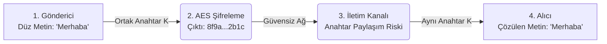
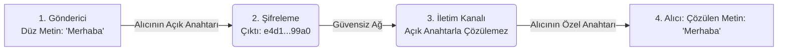
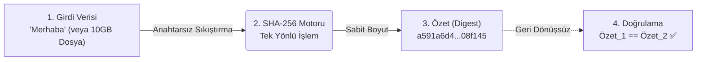

# 🔐 Kriptografi Yöntemleri ve Algoritmaları Teknik Rehberi
## ⚡ Kriptografi Veri Akışları

<b>🔑 Mod 1: Simetrik Şifreleme (AES-256) Akışı</b>

 

* **Adım 1 (Girdi):** Gönderici düz metni hazırlar. İletişim öncesinde gönderici ve alıcı aynı **Ortak Gizli Anahtara (`K`)** sahip olmalıdır.
* **Adım 2 (Şifreleme):** `AES_Enc("Merhaba", K)` işlemi ile veri `8f9a...2b1c` şeklinde okunamaz şifreli metne dönüştürülür.
* **Adım 3 (İletim):** Şifreli veri ağ üzerinden gönderilir. Anahtar güvenli paylaşılmadıysa ve yolda çalındıysa tüm iletişim çözülür.
* **Adım 4 (Şifre Çözme):** Alıcı aynı `K` anahtarını kullanarak şifreyi çözer ve `"Merhaba"` metnine ulaşır.

<b>🛡️ Mod 2: Asimetrik Şifreleme (RSA / ECC) Akışı</b>

 

* **Adım 1 (Girdi):** Gönderici, alıcının herkesle açıkça paylaştığı **Açık Anahtarını (Public Key)** alır. Gizli anahtar transferine gerek yoktur.
* **Adım 2 (Şifreleme):** Veri alıcının Açık Anahtarı ile kilitlenir (`e4d1...99a0`). Artık bu mesajı göndericinin kendisi bile çözemez.
* **Adım 3 (İletim):** Saldırgan şifreli mesajı ve Açık Anahtarı bilse dahi Özel Anahtar olmadan mesajı çözemez.
* **Adım 4 (Şifre Çözme):** Yalnızca alıcının kendisinde bulunan **Özel Anahtar (Private Key)** şifreyi çözer.

<b>🧬 Mod 3: Hash Fonksiyonu (SHA-256) Akışı</b>

 

* **Adım 1 (Girdi):** Herhangi bir boyuttaki metin, parola veya dosya fonksiyona verilir.
* **Adım 2 (Çığ Etkisi):** Anahtar kullanılmaz. Girdideki 1 bitlik değişim bile çıktıyı tamamen değiştirir.
* **Adım 3 (Sabit Çıktı):** Veri ne kadar büyük olursa olsun sabit 256-bitlik bir parmak izi üretilir.
* **Adım 4 (Bütünlük Kontrolü):** Özetten orijinal veriye geri dönülemez; yalnızca iki özetin birbiriyle eşleşip eşleşmediği doğrulanır.

---

## 🛡️ 1. Temel Kriptografi Yöntemleri

### 1.1. Simetrik Şifreleme (Gizli Anahtarlı Kriptografi)
Veriyi şifrelemek (*encryption*) ve şifreyi çözmek (*decryption*) için **aynı gizli anahtarın** kullanıldığı yöntemdir.

* **Ne İçin Kullanılır:** Büyük boyutlu dosyaların ve veritabanlarının şifrelenmesi, disk şifreleme (BitLocker, FileVault), Wi-Fi güvenliği (WPA2/WPA3), VPN tünelleri ve HTTPS bağlantılarında akan asıl veri trafiğinin korunması.
* **Örnek Algoritmalar:** AES (128/192/256 bit), ChaCha20, Blowfish, Twofish, 3DES.
* **Avantajları:** Matematiksel işlemleri hafif olduğu için **çok hızlıdır**, düşük donanım kaynağı tüketir ve gerçek zamanlı veri akışlarını gecikmesiz şifreler.
* **Dezavantajları:** Gizli anahtarın karşı tarafa güvenli ulaştırılması zordur (**anahtar dağıtım sorunu**); $n$ kişilik ağda $\frac{n(n-1)}{2}$ anahtar gerekir ve kimlik doğrulama sağlamaz.

### 1.2. Asimetrik Şifreleme (Açık Anahtarlı Kriptografi)
Matematiksel olarak birbirine bağlı **Açık Anahtar (Public Key)** ve **Özel Anahtar (Private Key)** çifti kullanır.

* **Ne İçin Kullanılır:** Güvenli anahtar değişimi (SSL/TLS el sıkışması), dijital imzalar (e-İmza), e-posta şifreleme (PGP), SSH bağlantıları ve kripto para işlemleri.
* **Örnek Algoritmalar:** RSA, ECC (ECDSA, Ed25519), Diffie-Hellman, ElGamal, ML-KEM (Kyber).
* **Avantajları:** Gizli anahtar paylaşım sorununu ortadan kaldırır; **dijital imza** ve **inkar edilemezlik** sağlar.
* **Dezavantajları:** Simetrik şifrelemeye göre **100 ila 1000 kat daha yavaştır**; büyük dosyaları doğrudan şifrelemek için uygun değildir.

### 1.3. Hash Fonksiyonları (Tek Yönlü Kriptografi)
Herhangi bir boyuttaki veriyi sabit uzunlukta benzersiz bir **özet (hash)** değerine dönüştürür. Anahtar kullanılmaz ve işlem **geri döndürülemezdir**.

* **Ne İçin Kullanılır:** Parolaların veritabanında saklanması, indirilen dosyaların bütünlük kontrolü, blokzincir bloklarının birbirine bağlanması.
* **Örnek Algoritmalar:** SHA-256, SHA-3, BLAKE3, Argon2 ve bcrypt (parola saklama için); MD5 ve SHA-1 (artık güvensizdir).
* **Avantajları:** Çok hızlıdır ve verideki en ufak değişikliği bile anında tespit eder (**Çığ etkisi**).
* **Dezavantajları:** Veri gizliliği sağlamaz; kısa parolalar için **Tuzlama (Salting)** uygulanmazsa sözlük saldırılarına açıktır.

### 1.4. Hibrit Kriptografi
Modern internet protokolleri (HTTPS / TLS 1.3, WhatsApp, Signal) üç yöntemi birleştirir:
1. **Asimetrik Şifreleme** ile kimlik doğrulanır ve geçici bir **oturum anahtarı** paylaşılır.
2. Akan tüm veri bu oturum anahtarıyla hızlı **Simetrik Şifreleme (AES / ChaCha20)** kullanılarak şifrelenir.
3. Paketlerin yolda değiştirilmediği **Hash / HMAC** fonksiyonlarıyla denetlenir.

---

## 📊 2. Yöntemlerin Karşılaştırma Tablosu

| Özellik | Simetrik Şifreleme | Asimetrik Şifreleme | Özetleme (Hash) |
| :--- | :--- | :--- | :--- |
| **Anahtar Yapısı** | Tek ortak gizli anahtar | Açık ve Özel anahtar çifti (2 anahtar) | Anahtar kullanılmaz |
| **İşlem Yönü** | Çift yönlü (Şifrelenir ve çözülür) | Çift yönlü (Şifrelenir ve çözülür) | Tek yönlü (Geri döndürülemez) |
| **Hız ve Performans** | Çok yüksek | Düşük (Yüksek işlemci yükü) | Çok yüksek |
| **Temel Güvenlik Amacı** | Veri Gizliliği (*Confidentiality*) | Anahtar Değişimi ve Kimlik Doğrulama | Veri Bütünlüğü (*Integrity*) |
| **Veri Boyutu Sınırı** | Sınırsız (Büyük veriler için ideal) | Çok küçük veriler (Genelde anahtarlar) | Sınırsız girdi, sabit boyutlu çıktı |
| **En Büyük Risk** | Gizli anahtarın transfer sırasında çalınması | Özel anahtarın çalınması veya kuantum saldırıları | Çakışma (*Collision*) ve sözlük saldırıları |
| **Standart Algoritmalar** | AES, ChaCha20, Twofish, 3DES | RSA, ECC, Diffie-Hellman, ML-KEM | SHA-256, SHA-3, BLAKE3, Argon2 |

---

## ⚙️ 3. Kriptografik Algoritmaların Değerlendirmesi

### 3.1. Simetrik Algoritmalar
* **AES (128/192/256-bit):** Küresel standart blok şifreleyicidir. İşlemci donanım hızlandırması (AES-NI) ile aşırı hızlıdır ve tam güvenlidir.
* **ChaCha20 (256-bit):** Modern akış şifreleme algoritmasıdır. Özel donanım olmayan mobil işlemcilerde AES'ten daha hızlıdır; TLS 1.3 ve WireGuard VPN'de kullanılır.
* **Blowfish / Twofish:** KeePass ve VeraCrypt gibi araçlarda kullanılan güvenli alternatiflerdir; ancak Blowfish'in 64-bit blok boyutu büyük dosyalarda önerilmez.
* **DES / 3DES (Kullanımdan Kaldırıldı):** 56-bit DES kolayca kırılır; 3DES ise çok yavaş ve eski olduğu için emekliye ayrılmıştır.

### 3.2. Asimetrik Algoritmalar
* **RSA (2048/3072/4096-bit):** Asal çarpanlara ayırma zorluğuna dayanır. Çok yaygın desteklenir ancak güvenlik için çok büyük anahtarlar gerektirir ve yavaştır.
* **ECC (ECDSA, Ed25519, ECDH):** Eliptik eğri matematiğini kullanır. RSA-3072'nin sağladığı güvenliği sadece **256-bit** anahtarla ve çok daha yüksek hızda sunar.
* **Diffie-Hellman (DH / ECDH):** İki tarafın güvensiz ağda ortak simetrik anahtar üretmesini ve **İleriye Dönük Gizlilik** (*Forward Secrecy*) elde etmesini sağlar.
* **ML-KEM (Kyber) & ML-DSA (Dilithium):** Kuantum bilgisayar saldırılarına dayanıklı yeni nesil NIST standartlarıdır.

### 3.3. Özetleme (Hash) Algoritmaları
* **SHA-2 (SHA-256 / SHA-512):** TLS, Git ve Bitcoin'de kullanılan hızlı ve güvenli endüstri standardıdır.
* **SHA-3 (Keccak):** Sünger mimarisine sahip modern NIST standardıdır; uzunluk uzatma saldırılarına karşı tam dirençlidir.
* **BLAKE2 / BLAKE3:** Paralel işleme yeteneği sayesinde SHA-2 ve SHA-3'ten birkaç kat daha hızlı çalışan modern özetleme algoritmasıdır.
* **Argon2id / bcrypt / PBKDF2:** Kasıtlı olarak yavaşlatılmış ve **bellek-yoğun (RAM tüketen)** parola saklama algoritmalarıdır; GPU/ASIC kaba kuvvet saldırılarını engeller.
* **MD5 ve SHA-1 (Kırıldı):** Çakışma (*collision*) üretilebildiği için kriptografik olarak kırılmıştır; güvenlik amaçlı kullanılmamalıdır.

---

## 📋 4. Algoritmaların Karşılaştırma Tablosu

| Algoritma | Kategori | Anahtar / Çıktı Boyutu | Hız | Güvenlik Durumu | Temel Kullanım Amacı |
| :--- | :--- | :--- | :--- | :--- | :--- |
| **AES** | Simetrik (Blok) | 128 / 192 / 256 bit | Çok Yüksek (Donanımla) | ✅ Çok Güvenli | Disk, dosya, VPN ve HTTPS veri şifreleme |
| **ChaCha20** | Simetrik (Akış) | 256 bit | Çok Yüksek (Yazılımda) | ✅ Çok Güvenli | Mobil TLS trafiği, WireGuard VPN |
| **Twofish** | Simetrik (Blok) | 128 / 192 / 256 bit | Yüksek | ✅ Güvenli | Disk ve parola veritabanı şifreleme |
| **3DES** | Simetrik (Blok) | 112 / 168 bit | Düşük | ⚠️ Güvensiz (Eski) | Eski bankacılık ve ATM sistemleri |
| **RSA** | Asimetrik | 2048 - 4096 bit | Yavaş | ✅ Güvenli (Klasik) | TLS sertifikaları, e-İmza, anahtar değişimi |
| **ECC (Ed25519 / P-256)** | Asimetrik | 256 - 521 bit | Orta / Yüksek | ✅ Çok Güvenli (Klasik) | Modern TLS, SSH, kripto para, mesajlaşma |
| **ML-KEM (Kyber)** | Asimetrik (PQC) | ~1184 - 1568 bayt | Yüksek | 🛡️ Kuantum Dirençli | Kuantum bilgisayarlara karşı anahtar değişimi |
| **SHA-256 / SHA-3** | Özetleme (Hash) | 256 / 512 bit | Çok Yüksek | ✅ Çok Güvenli | Veri bütünlüğü, dijital imza, blokzincir |
| **BLAKE3** | Özetleme (Hash) | 256 bit (Uzatılabilir) | Aşırı Yüksek | ✅ Çok Güvenli | Büyük dosya doğrulama, hızlı bütünlük kontrolü |
| **Argon2id / bcrypt** | Parola Özetleme | Değişken (Tuzlanmış) | Kasıtlı Yavaş | ✅ Çok Güvenli | Kullanıcı parolalarının veritabanında saklanması |
| **MD5 / SHA-1** | Özetleme (Hash) | 128 / 160 bit | Çok Yüksek | ❌ **Kırıldı (Güvensiz)** | Yalnızca güvenlik dışı basit dosya kontrolü |

---

## 📌 Proje Analizi ve Savunma Sanayii Değerlendirmesi

* **Bu Doküman Neyi Hedefler?**  
  Simetrik, Asimetrik, Özetleme (Hash) ve Kuantum Sonrası Kriptografi (PQC - ML-KEM/Kyber) algoritmalarının çalışma prensiplerini, hız/performans dengelerini, avantaj-dezavantajlarını ve kullanım alanlarını bütünsel bir mühendislik rehberi olarak sunmayı hedefler.
* **Normalde (Sivil / Endüstriyel Alanda) Ne İçin Kullanılır?**  
  Ağ güvenliği protokolleri (TLS 1.3, VPN), kurumsal veri tabanı şifreleme, güvenli parola saklama (Argon2id/bcrypt) ve blokzincir/e-İmza altyapılarının tasarımında temel başvuru kaynağı olarak kullanılır.
* **Savunma Sanayii ve Askeri Sistemlerde Nerede Kullanılabilir?**  
  Modern askeri haberleşme sistemlerinde (ör. Milli Kripto Cihazları, Taktik Saha Muhabere Sistemleri ve İHA Uydu/RF Veri Linkleri) kullanılan **Hibrit Kriptografi** mimarisinin teorik altyapısını oluşturur:
  1. Görev öncesinde veya bağlantı başlangıcında **ECC / ECDH veya Kuantum Dirençli ML-KEM** ile güvenli anahtar değişimi yapılır,
  2. Uçuş/operasyon sırasında gerçek zamanlı akan telemetri, ses ve görüntü verileri gecikme olmaması için bu projede uygulanan **AES-256 / ChaCha20** simetrik algoritmalarıyla şifrelenir,
  3. Paketlerin elektronik taarruz (Spoofing / Man-in-the-Middle) ile yolda değiştirilmediği ise **SHA-256 / BLAKE3** bütünlük özetleriyle doğrulanır.
