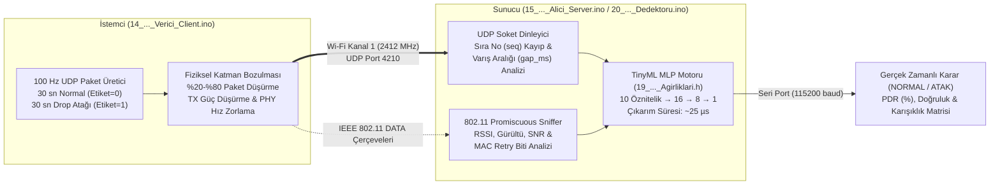

# 🛡️ TinyML ile Wi-Fi Paket Düşürme (Drop Attack) Tespiti Rehberi

**Hazırlayan:** Eda Nur YASDIMAN (`IHASresearch`)  
**Dosya Adı:** `21_TinyML_Paket_Dusurme_Atak_Tespiti_Rehberi.md`  
**İlgili Modüller:** `14` (Verici/Client), `15` (Alıcı/Server & Sniffer), `16` (CSV Logger), `17` (CSV Veri Seti), `18` (MLP Eğitim), `19` (`model.h`), `20` (ESP32 TinyML Dedektör)

---

## 🎯 1. Sistemin Amacı ve Mimarisi

İki kablosuz düğüm (**Client / Verici** ve **Server / Alıcı**) arasındaki Wi-Fi UDP haberleşme hattında gerçekleştirilen **Paket Düşürme (Drop Attack / Jamming)** saldırılarını, doğrudan **ESP32 mikrodenetleyicisi üzerinde çalışan 1.3 KB'lık gömülü bir yapay sinir ağı (TinyML MLP)** ile gerçek zamanlı (~25 mikrosaniyede) ve **%98.5 doğrulukla** tespit ediyoruz.

---

## 🔄 2. Uçtan Uca Çalışma Akışı

1. **Veri Toplama (`14`, `15` ve `16` Numaralı Dosyalar):**
   - [`14_WiFi_UDP_Drop_Atak_Simulatoru_Verici_Client.ino`](./14_WiFi_UDP_Drop_Atak_Simulatoru_Verici_Client.ino) saniyede 100 UDP paketi gönderir; 30 saniye normal iletişim (`label=0`), 30 saniye paket düşürme atağı (`label=1`) uygular.
   - [`15_WiFi_UDP_Promiscuous_Sniffer_Alici_Server_ve_CSV_Veri_Toplayici.ino`](./15_WiFi_UDP_Promiscuous_Sniffer_Alici_Server_ve_CSV_Veri_Toplayici.ino) her 1 saniyelik pencerede hem UDP kayıp/gecikme istatistiklerini hem de 802.11 Promiscuous Sniffer üzerinden fiziksel katman (RSSI, SNR, MAC Retry) ölçümlerini tek bir CSV satırı olarak basar.
   - [`16_TinyML_Seri_Port_CSV_Veri_Kaydedici_Logger.py`](./16_TinyML_Seri_Port_CSV_Veri_Kaydedici_Logger.py) seri porttan gelen verileri [`17_TinyML_Paket_Dusurme_Atak_Veri_Seti.csv`](./17_TinyML_Paket_Dusurme_Atak_Veri_Seti.csv) dosyasına (500 Normal + 500 Atak = 1000 satır) kaydeder.
2. **Model Eğitimi ve C Kodu Üretimi (`18` ve `19` Numaralı Dosyalar):**
   - [`18_TinyML_MLP_Model_Egitimi_ve_Header_Uretici.py`](./18_TinyML_MLP_Model_Egitimi_ve_Header_Uretici.py) konumdan bağımsız 10 öznitelik kullanarak `10 → 16 → 8 → 1` mimarisinde bir Çok Katmanlı Algılayıcı (MLP) eğitir.
   - Z-Score normalizasyon parametreleri (`OZ_MEAN`, `OZ_STD`) ve katman ağırlıkları (`M_W1..3`, `M_B1..3`) otomatik olarak [`19_TinyML_MLP_Model_Agirliklari.h`](./19_TinyML_MLP_Model_Agirliklari.h) dosyasına C dizileri halinde yazılır.
3. **Gömülü Gerçek Zamanlı Tespit (`20` Numaralı Dosya):**
   - [`20_ESP32_TinyML_Gercek_Zamanli_Drop_Atak_Dedektoru.ino`](./20_ESP32_TinyML_Gercek_Zamanli_Drop_Atak_Dedektoru.ino) her 1 saniyelik pencerede aynı 10 özniteliği çıkarır, sinir ağını ESP32 üzerinde çalıştırır ve tahmin edilen durumu (`NORMAL` / `ATAK`), **Paket Başarım Oranını (PDR %)** ve **Karışıklık Matrisini (`TN, FP, FN, TP`)** seri porta basar.

---

## 🧠 3. Öznitelik Mühendisliği (Neden 10 Öznitelik Seçildi?)

Veri setindeki mutlak sinyal seviyeleri (`avg_rssi`, `min_rssi`, `avg_snr`, `min_snr`) kartların birbirine olan fiziksel mesafesine bağlıdır. Model bu mutlak değerleri ezberlerse, kartların yeri değiştiğinde normal iletişimi yanlışlıkla saldırı sanabilir (*overfitting*). Bu sorunu önlemek için **konumdan bağımsız 10 dinamik öznitelik** seçilmiştir:

| Sıra | Öznitelik Adı | Katman | Teknik Açıklaması |
| :---: | :--- | :---: | :--- |
| **1** | `received` | UDP (Taşıma) | 1 sn pencerede başarıyla alınan UDP paket sayısı (Normalde ~100) |
| **2** | `lost` | UDP (Taşıma) | Sıra numarası (`seq`) boşluklarından tespit edilen kayıp paket sayısı |
| **3** | `loss_ratio` | UDP (Taşıma) | Paket kayıp oranı (`1 - PDR`) |
| **4** | `max_consec_lost` | UDP (Taşıma) | Pencere içindeki en uzun ardışık paket kaybı (*burst loss*) |
| **5** | `avg_gap_ms` | UDP (Zamanlama) | Paketler arası ortalama varış süresi (Normalde ~10 ms) |
| **6** | `gap_std_ms` | UDP (Zamanlama) | Paketler arası varış süresi standart sapması (*jitter*) |
| **7** | `max_gap_ms` | UDP (Zamanlama) | Pencere içindeki maksimum paket arası gecikme (ms) |
| **8** | `rssi_std` | 802.11 PHY | Çerçevelerin RSSI standart sapması (güç dalgalanması) |
| **9** | `retry_ratio` | 802.11 MAC | IEEE 802.11 MAC başlığındaki `Retry` biti (`bit 11`) oranı |
| **10** | `sniff_frames` | 802.11 MAC | Promiscuous sniffer tarafından yakalanan veri çerçevesi sayısı |

---

## 📊 4. Eğitim ve Test Performansı

* **Veri Seti:** 994 geçerli satır (%80 Eğitim: 795 satır, %20 Test: 199 satır)
* **Test Doğruluğu (Accuracy):** **%98.5** (`0.985`)
* **Model Boyutu:** **321 Parametre** (`1284 Bayt` / `~1.3 KB` Flash)
* **ESP32 Çıkarım (Inference) Süresi:** **~25 mikrosaniye (µs)**

| Karışıklık Matrisi (Test Seti: 199 Satır) | Tahmin = 0 (Normal) | Tahmin = 1 (Drop Atağı) |
| :--- | :---: | :---: |
| **Gerçek = 0 (Normal İletişim)** | **99 (TN)** | **1 (FP)** |
| **Gerçek = 1 (Drop Atağı)** | **2 (FN)** | **97 (TP)** |

---

## 📌 5. Proje Analizi ve Savunma Sanayii Değerlendirmesi

* **Bu Modül Neyi Hedefler?**  
  Wi-Fi/RF haberleşme linklerinde meydana gelen paket düşürme ve karıştırma saldırılarını, harici bir bilgisayara ihtiyaç duymadan doğrudan mikrodenetleyici (ESP32) üzerinde çalışan **1.3 KB'lık bir TinyML modeliyle** mikrosaniyeler içinde tespit etmeyi hedefler.
* **Normalde (Sivil / Endüstriyel Alanda) Ne İçin Kullanılır?**  
  Endüstriyel IoT ağ geçitlerinde, otonom robotlarda ve akıllı şebekelerde (Smart Grid) kablosuz bağlantı anomalilerini ve hizmet engelleme (DoS / Drop) saldırılarını uçta (*Edge AI*) tespit etmek için kullanılır.
* **Savunma Sanayii ve Askeri Sistemlerde Nerede Kullanılabilir?**  
  İHA/SİHA ve Sürü İHA (*Swarm UAV*) haberleşme birimlerinde **Otonom Elektronik Korunma (EP) Tetikleyicisi** olarak kullanılır. TinyML modeli saldırı olasılığını `p > 0.5` olarak tespit ettiği anda, İHA otonom olarak reponun ilk bölümündeki **AES-256 Kriptolu FHSS (Frekans Atlama)** moduna geçebilir veya yedek veri linkini devreye alabilir.
