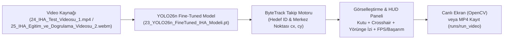

# 🎯 YOLO26n ve ByteTrack ile Gerçek Zamanlı İHA (UAV) Tespit ve Takip Rehberi

**Dosya Adı:** `26_YOLO26n_IHA_Tespit_ve_Takip_Rehberi.md`  
**İlgili Modüller:** `22` (YOLO26n + ByteTrack Python Uygulaması), `23` (`YOLO26n` Fine-Tuned Model), `24` (Test Videosu 1), `25` (Eğitim/Doğrulama Videosu 2)

---

## 📋 1. Sistem Mimarisi ve Çalışma Akışı

[`25_IHA_Egitim_ve_Dogrulama_Videosu_2.webm`](./25_IHA_Egitim_ve_Dogrulama_Videosu_2.webm) veri seti ile ince ayarı (*fine-tuning*) yapılmış **YOLO26n** modeli ([`23_YOLO26n_FineTuned_IHA_Modeli.pt`](./23_YOLO26n_FineTuned_IHA_Modeli.pt)) ve **ByteTrack** algoritması kullanılarak videolardaki İnsansız Hava Araçları (İHA / Drone) gerçek zamanlı olarak tespit edilir, benzersiz ID ile takip edilir ve hareket yörüngesi (*trajectory*) çizilir.



---

## 📂 2. İlgili Dosyalar

| Sıra | Dosya Adı | Görevi |
| :---: | :--- | :--- |
| **22** | [`22_YOLO26n_ve_ByteTrack_IHA_Tespit_ve_Takip_Sistemi.py`](./22_YOLO26n_ve_ByteTrack_IHA_Tespit_ve_Takip_Sistemi.py) | YOLO26n + ByteTrack İHA tespit, merkez crosshair, yörünge takip ve HUD uygulaması |
| **23** | [`23_YOLO26n_FineTuned_IHA_Modeli.pt`](./23_YOLO26n_FineTuned_IHA_Modeli.pt) | Fine-tune edilmiş tek sınıflı (`IHA`) YOLO26n ağırlık dosyası |
| **24** | [`24_IHA_Test_Videosu_1.mp4`](./24_IHA_Test_Videosu_1.mp4) | Test videosu 1 (Farklı açı ve arka planda İHA uçuşu) |
| **25** | [`25_IHA_Egitim_ve_Dogrulama_Videosu_2.webm`](./25_IHA_Egitim_ve_Dogrulama_Videosu_2.webm) | Eğitim ve doğrulama videosu 2 (Quadcopter uçuşu) |

---

## 🚀 3. Kurulum ve Kullanım

### Gerekli Kütüphaneler
```powershell
pip install ultralytics opencv-python numpy
```

### Parametreler ve Çalıştırma
[`22_YOLO26n_ve_ByteTrack_IHA_Tespit_ve_Takip_Sistemi.py`](./22_YOLO26n_ve_ByteTrack_IHA_Tespit_ve_Takip_Sistemi.py) dosyasının üst kısmındaki **PARAMETRELER** bloğundan model, video ve takip ayarlarını düzenleyebilirsiniz:

```python
MODEL = ROOT / "23_YOLO26n_FineTuned_IHA_Modeli.pt"          # Fine-tune edilmiş YOLO26n ağırlık dosyası
VIDEO = ROOT / "25_IHA_Egitim_ve_Dogrulama_Videosu_2.webm"   # Test için: ROOT / "24_IHA_Test_Videosu_1.mp4"
CONF = 0.25                                                  # Güven eşiği (Confidence threshold)
IMGSZ = 640                                                  # Model giriş boyutu
TRACK = True                                                 # ByteTrack ile ID ve yörünge izi takibi
SHOW = True                                                  # Canlı pencerede göster
SAVE = False                                                 # Çıktıyı runs/run_video/ altına MP4 olarak kaydet
```

Uygulamayı başlatmak için:
```powershell
python 22_YOLO26n_ve_ByteTrack_IHA_Tespit_ve_Takip_Sistemi.py
```

### Canlı Pencere Klavye Kısayolları
| Tuş | İşlevi |
| :---: | :--- |
| **`q`** veya **`ESC`** | Uygulamadan çıkar ve terminalde **İHA Tespit Performans Raporu** (Toplam Kare, Tespit Oranı %, Ortalama FPS) basar |
| **`SPACE` (Boşluk)** | Videoyu o karede duraklatır / devam ettirir |
| **`t`** | Yörünge takip çizgisini (*Trajectory*) ve ByteTrack takibini açar / kapatır |
| **`v`** | Uygulamayı kapatmadan `25_IHA_Egitim_ve_Dogrulama_Videosu_2.webm` ve `24_IHA_Test_Videosu_1.mp4` videoları arasında anında geçiş yapar |

---

## 📌 4. Proje Analizi ve Savunma Sanayii Değerlendirmesi

* **Bu Modül Neyi Hedefler?**  
  Görüntü işleme ve derin öğrenme (**YOLO26n + ByteTrack**) kullanarak hareketli hava hedeflerini (İHA/Drone) yüksek kare hızında (FPS) tespit etmeyi, hedef merkezini (`cx, cy`) kilitlemeyi ve geçmiş hareket yörüngesini çıkarmayı hedefler.
* **Normalde (Sivil / Endüstriyel Alanda) Ne İçin Kullanılır?**  
  Havalimanları ve kritik tesis çevresinde hava sahası güvenliği, otonom İHA'larda görsel çarpışma önleme (*Sense & Avoid*) ve hava trafiği izleme sistemlerinde kullanılır.
* **Savunma Sanayii ve Askeri Sistemlerde Nerede Kullanılabilir?**  
  **Hava Savunma ve Anti-Drone (C-UAS) Elektro-Optik Sistemleri:** Radar kesit alanı çok küçük olan alçak irtifa mikro/mini İHA ve FPV kamikaze drone'larının elektro-optik/termal kameralarla tespit edilip otomatik taret veya önleyici İHA (*Interceptor UAV*) tarafından kilitlenerek etkisiz hale getirilmesinde kullanılır.
